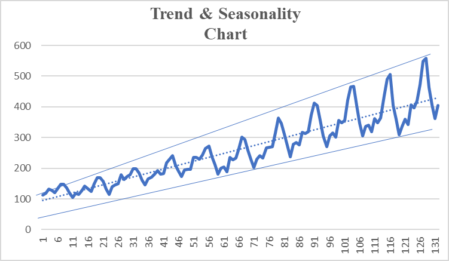
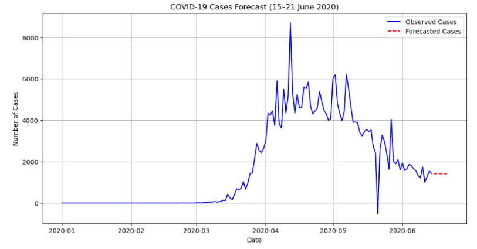
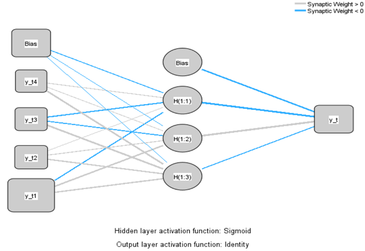
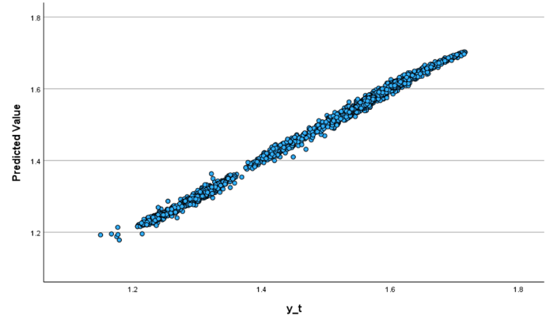
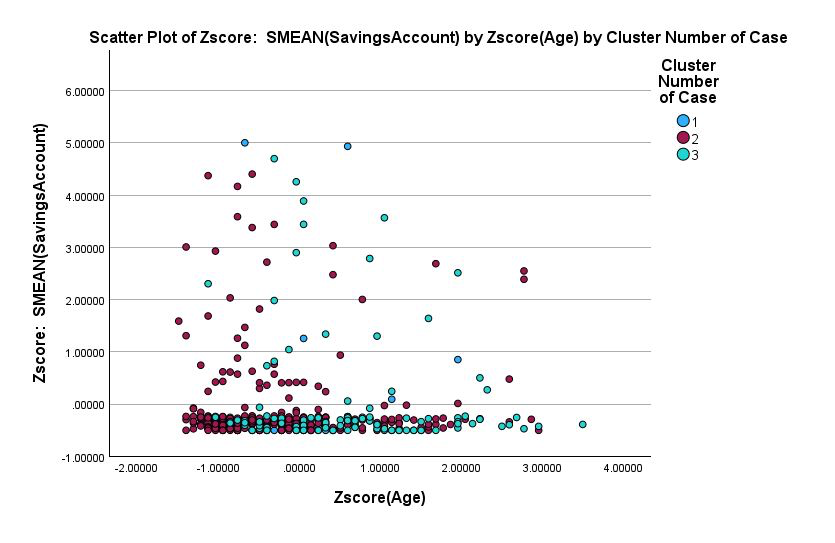

# Business Analytics in Practice: 6 Applied Projects

**MSc Business Analytics module BNM863, Aston University**
**Tools:** Excel, IBM SPSS (ARIMA, neural networks, logistic regression, clustering, regression), Python (basic, guided)

Six short projects, each answering a different business question with a different technique: forecasting, machine learning, classification, segmentation and conjoint analysis.

| # | Business question | Technique | Tool |
|---|---|---|---|
| 1 | How many airline passengers should we expect next year? | Time series decomposition (moving average, seasonal indices) | Excel |
| 2 | How many COVID-19 cases will the UK see next week? | ARIMA (1,1,1) | SPSS, Python |
| 3 | What will the GBP/USD exchange rate be tomorrow? | Artificial neural network (MLP) | SPSS |
| 4 | Which supermarket customers are high spenders? | Binary logistic regression | SPSS |
| 5 | How should a bank segment its customers? | K-means and hierarchical clustering | SPSS |
| 6 | Which phone features matter most to buyers? | Conjoint analysis (regression on ranked profiles) | SPSS, Excel |

---

## 1. Airline passenger forecasting (Excel)

**Data:** monthly US airline passengers, 1949–1959 (132 months).

**What I did:** calculated a 12-month moving average to find the trend, divided actuals by the moving average to get 12 monthly seasonal indices, and compared additive and multiplicative models. I chose **multiplicative**, because the seasonal swings grew as the trend grew. Then I forecast 1960 as *moving average × seasonal index*, and measured accuracy with MAE and MSE.

**Finding:** a clear upward trend, with summer peaks and winter dips that get bigger every year. That's useful for airline scheduling and capacity planning.

## 2. COVID-19 case forecasting with ARIMA (SPSS)

**Data:** UK daily COVID-19 cases, 1 January to 14 June 2020.

**What I did:** the time series plot and ACF/PACF showed the series wasn't stationary, so I applied first-order differencing. The ACF/PACF patterns pointed to **ARIMA(1,1,1)**. I checked the residuals (no remaining autocorrelation, Ljung-Box test, normality) and forecast 15–21 June 2020.

**Finding:** the forecast levelled off at about **1,410 cases per day** for the week. Outside factors like government action limit how reliable any longer forecast can be.

## 3. Exchange rate prediction with a neural network (SPSS)

**Data:** daily GBP/USD rate (FRED series DEXUSUK), 4 January 2010 to 7 August 2020.

**What I did:** handled missing days, used ACF/PACF to choose **4 lagged inputs** (t−1 to t−4), scaled the data, and split it into training, testing and holdout sets. I then built a multilayer perceptron with one hidden layer and an identity output.

**Finding:** low, consistent errors across training, testing and holdout. Yesterday's rate (t−1) was by far the most important input (100% normalised importance, against 6.6% for t−3 and 2% for t−4). Forecast for 8 August 2020: **≈ 1.3023 USD per GBP**.

## 4. Supermarket high spender classification (SPSS)

**Data:** loyalty-card transactions from a UK supermarket case study (75 valid customers, 26 weeks; convenience, superstore and online).

**What I did:** created a binary target (low spend £50 or less, high spend over £50), checked for missing values and outliers, and built a **binary logistic regression** on value-product purchases, top-range purchases and store type.

**Finding:**
- Classification accuracy rose from **57.3%** (no predictors) to **92%** with the model.
- Nagelkerke R² = **0.846**, and Hosmer-Lemeshow p = 0.472 (good fit).
- Buying more value products significantly lowered the odds of being a high spender (B = −0.359, p = 0.004). Online shoppers leaned towards high spend.

**Recommendation:** personalised offers for online shoppers, and bundle promotions to move value-product shoppers to bigger baskets.

## 5. Bank customer segmentation (SPSS)

**Data:** 425 bank customers with demographic, employment, savings and credit-risk fields.

**What I did:** filled missing values, coded the categorical fields, standardised the variables as z-scores, then ran **K-means (3 clusters)** and **hierarchical clustering** (Ward's method, squared Euclidean distance, dendrogram) to check the groups.

**Finding:** three clear segments: younger customers with low savings and higher credit risk, middle-aged customers with medium savings and risk, and older customers with high savings and low risk. Each one needs different products, marketing and risk support.

## 6. New mobile phone design with conjoint analysis (SPSS, Excel)

**Data:** 30 ranked phone profiles built from 4 attributes: battery life, screen size, camera and price.

**What I did:** dummy-coded the attribute levels, ran a linear regression on the preference scores, and turned the coefficients into **utility scores** for each level.

**Finding:** battery life and camera quality mattered most alongside price. The best-scoring design was **24-hour battery, 108 MP camera, 6.1-inch screen at £799**. Utility scores also show *how much* one option beats another, which a plain ranking can't.

---

## Files
- `Business_Analytics_Portfolio_Report.pdf`: full report with all outputs
- `images/`: key charts
